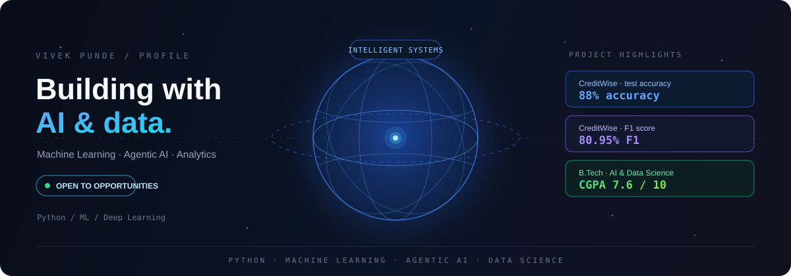

<div align="center">



**Aspiring AI/ML Engineer · Data Scientist · Python Developer**

[](https://github.com/vivekpunde05)
[](https://github.com/vivekpunde05?tab=followers)

</div>

------------------------------------------------------------------------

## 📊 By the Numbers

  -----------------------------------------------------------------------
  Focus                               Highlights
  ----------------------------------- -----------------------------------
  🎓 Education                        B.Tech in Artificial Intelligence
                                      and Data Science (2023--2027)

  📈 Academic performance             CGPA: 7.6/10

  🤖 Credit risk ML                   88% test accuracy and 80.95%
                                      F1-score for CreditWise

  💼 Industry experience              Data Analyst Intern at Bluestock
                                      Fintech; Agentic AI Intern at
                                      Innomatics Research Labs

  🧠 Core interests                   Machine Learning, Agentic AI, Data
                                      Analytics, Computer Vision
  -----------------------------------------------------------------------

------------------------------------------------------------------------

## 👋 About Me

I'm a B.Tech student in Artificial Intelligence and Data Science at
Loknete Shamrao Peje Government College of Engineering, Ratnagiri,
Maharashtra.

I enjoy building practical solutions using Python, machine learning,
data processing, API integration, and intelligent automation. I'm
currently looking for entry-level opportunities in **Machine Learning
Engineering, AI Engineering, and Data Science**.

-   🔭 Building ML applications and data-driven platforms
-   🤖 Exploring Agentic AI, LangChain, and LangGraph
-   📊 Interested in analytics, predictive modelling, and visualization
-   🧪 Learning through hands-on projects, internships, and hackathons
-   🤝 Open to collaboration on AI/ML and data science projects

------------------------------------------------------------------------

## 💼 Experience

### Data Analyst Intern --- Bluestock Fintech

**May 2026 -- July 2026**\
*Project: Financial Intelligence Platform*

-   Organized, analyzed, and interpreted financial data for the
    Financial Intelligence Platform.
-   Supported data-processing and analysis workflows to produce clear
    insights.
-   Strengthened financial data interpretation and analytical skills.

### Agentic AI Intern --- Innomatics Research Labs

**February 2026 -- May 2026**

-   Gained practical exposure to Agentic AI and intelligent automation
    workflows.
-   Applied Python programming and AI technologies to practical tasks.
-   Explored AI-driven application development.

------------------------------------------------------------------------

## 🚀 Featured Projects

### 💳 CreditWise --- Intelligent Loan Approval & Credit Risk Prediction

A machine learning system that predicts loan approval eligibility using
applicant demographics, income, credit scores, debt ratios, and
collateral values.

-   Performed missing-value imputation, exploratory data analysis,
    categorical encoding, and feature scaling.
-   Compared Logistic Regression, K-Nearest Neighbors (KNN), and
    Gaussian Naive Bayes.
-   Engineered quadratic features from credit scores and debt-to-income
    ratios.
-   Achieved **88% accuracy** and an **80.95% F1-score** with Logistic
    Regression on the test dataset.

**Tech:** Python · Pandas · NumPy · Scikit-learn · Matplotlib · Seaborn

### 🛒 SmartCart --- E-Commerce Customer Segmentation & Behavioral Intelligence

A customer analytics platform that identifies behavioral groups from
transactional data and supports targeted marketing decisions.

-   Applied PCA and Agglomerative Clustering for customer segmentation.
-   Evaluated clusters using the Elbow Method and Silhouette Score.
-   Built a Streamlit dashboard with customer personas, campaign
    insights, and ROI simulation.
-   Added a KNN classification module with batch CSV processing for new
    customer profiles.

**Tech:** Python · Pandas · NumPy · Scikit-learn · PCA · Agglomerative
Clustering · Streamlit · Plotly

### 🖼️ CIFAR-10 Image Classification Using CNNs

A deep learning model that classifies CIFAR-10 images into 10 categories
using a Convolutional Neural Network.

-   Built a multilayer CNN with convolution, ReLU, max-pooling, and
    fully connected layers.
-   Applied image normalization and DataLoader batching.
-   Trained for 10 epochs using the Adam optimizer and Cross-Entropy
    Loss.
-   Evaluated model performance on the test dataset.

**Tech:** Python · PyTorch · Torchvision · CNN · Deep Learning

------------------------------------------------------------------------

## 🛠️ Technical Skills

### Languages & Development


### Machine Learning & Deep Learning


**Concepts:** Logistic Regression · KNN · Gaussian Naive Bayes · Feature
Engineering · Model Evaluation · Classification · Clustering · PCA ·
Predictive Modelling · CNN · Image Preprocessing

### Agentic AI & LLM Applications

**LangChain · LangGraph · Agentic AI · Intelligent Automation
Workflows**

### Data Analysis & Visualization


**Concepts:** Exploratory Data Analysis (EDA) · Data Preprocessing ·
Data Visualization · Financial Data Analysis

------------------------------------------------------------------------

## 🎓 Education

**B.Tech --- Artificial Intelligence and Data Science**\
Loknete Shamrao Peje Government College of Engineering, Ratnagiri,
Maharashtra\
2023--2027 · **CGPA: 7.6/10**

**HSC (Class XII)** --- Sanjivani Sainiki School & Junior College,
Kopargaon · 2023 · 65.17%\
**SSC (Class X)** --- Sanjivani Sainiki School & Junior College,
Kopargaon · 2021 · 88.60%

------------------------------------------------------------------------

## 📜 Certifications & Training

-   **Artificial Intelligence and Machine Learning --- Virtual
    Internship** (August--September 2025)\
    30-day program covering AI/ML concepts, data handling, and
    real-world application development.
-   **Data Structures and Algorithms in Python** (October--November
    2024)\
    Arrays, stacks, queues, linked lists, trees, graphs, and
    problem-solving; performance score: **81%**.

------------------------------------------------------------------------

## 🏆 Activities & Achievements

-   Participated in **Smart India Hackathon (SIH)** and **AI for Bharat
    Hackathon**, building AI-driven solutions.
-   Attended the **AI/ML for Geodata Analytics** course by IIRS/ISRO.
-   Participated in technical AI/ML webinars and workshops.

------------------------------------------------------------------------

## 📈 GitHub Statistics

```{=html}
<p align="center">
```
``{=html}
``{=html}
```{=html}
</p>
```
```{=html}
<p align="center">
```
``{=html}
```{=html}
</p>
```

------------------------------------------------------------------------

## 🤝 Connect With Me

-   📧 Email: <vivekpunde6@gmail.com>
-   💼 LinkedIn:
    [linkedin.com/in/vivekpunde](https://linkedin.com/in/vivekpunde)
-   🐙 GitHub:
    [github.com/vivekpunde05](https://github.com/vivekpunde05)

------------------------------------------------------------------------

```{=html}
<p align="center">
```
`<i>`{=html}Learn continuously. Build meaningfully. Turn data into
impact.`</i>`{=html}
```{=html}
</p>
```